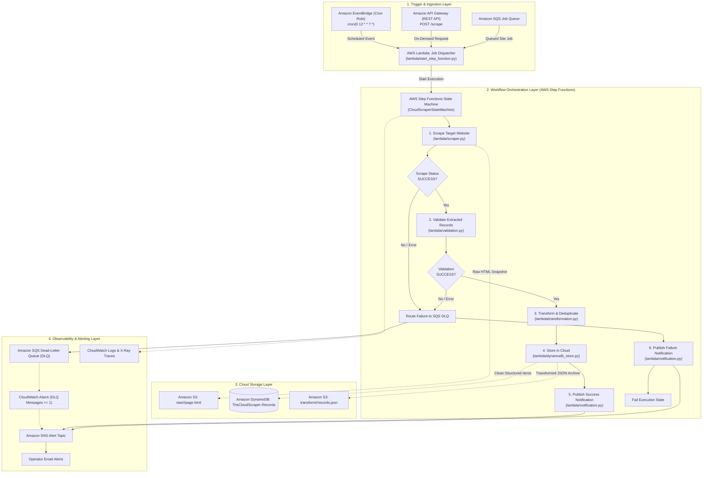

# The Cloud Scraper — Serverless Automated Data Pipeline

> **Course:** Cloud Architecture Design (CAD)  
> **Project Name:** The Cloud Scraper — Serverless Automated Data Pipeline  
> **Derived From:** AWS Step Functions ETL Pipeline Pattern  
> **Status:** Working Model & Automated Test Suite Passing (20/20 tests passed)

---

## 1. Executive Summary & Objective

**The Cloud Scraper** is a production-ready, serverless automated data ingestion and processing pipeline designed on AWS. 

In the original repository pattern, data ingestion was purely reactive and file-driven: users had to manually upload static CSV files into an S3 bucket to trigger execution. **The Cloud Scraper** transforms this architecture into an **active, automated web intelligence pipeline**:

1. **Automated Ingestion:** Periodically fetches web data on configurable schedules via **Amazon EventBridge** or on-demand via **Amazon API Gateway** (REST endpoint).
2. **Resilient Web Scraping:** Extracts structured content (titles, prices, ratings, authors, tags, URLs) using Python `Requests` and `BeautifulSoup` according to declarative, site-specific selector rules.
3. **Data Quality & Hygiene:** Validates extracted records against strict schema and type rules, isolating malformed entities and rejecting corrupted feeds.
4. **Deterministic Deduplication:** Normalizes text and numeric formats, computing a deterministic **SHA-256 fingerprint hash** per entity to prevent redundant storage across recurring scrape cycles.
5. **Dual-Tier Cloud Storage:**
   - **Amazon S3 Data Lake:** Preserves immutable raw HTML snapshots (`raw/`) and versioned transformed JSON datasets (`transform/`).
   - **Amazon DynamoDB:** Stores queryable, structured records with partition key `site_id`, sort key `record_id`, and a Global Secondary Index on `content_hash` for fast identity lookups. Complete data lineage is maintained with `source_url` and ISO 8601 timestamps (`scraped_at`, `transformed_at`).
6. **Decoupling & Fault Isolation:** Employs **Amazon SQS** with an associated **Dead-Letter Queue (DLQ)** to isolate persistent scraping failures and network timeouts without stalling downstream services.
7. **Workflow Orchestration:** Coordinated by **AWS Step Functions**, implementing exponential retry backoffs, task timeouts, and fail-safe catchers.
8. **Observability & FinOps:** Enriches execution logs in **Amazon CloudWatch**, issues operational alerts through **Amazon SNS**, and calculates estimated per-run serverless execution costs.

---

## 2. Architecture & Workflow

### Architectural Diagram



---

## 3. Transition from Original Pattern (Architectural Rationale)

The original repository (`aws-samples/aws-step-functions-etl-pipeline-pattern`) implemented a batch file processing pattern. Here is how each component was evolved:

| Pipeline Stage | Original Architecture | The Cloud Scraper Evolution | Rationale for Change |
| :--- | :--- | :--- | :--- |
| **Ingestion** | S3 `ObjectCreated` event on CSV file uploads. | EventBridge cron rules + API Gateway REST API + SQS. | Eliminates manual upload bottleneck; enables fully autonomous, scheduled web harvesting and on-demand scraping. |
| **Extraction** | Read CSV via Pandas into memory. | Configurable HTTP scraping via Requests + BeautifulSoup. | Dynamically parses live HTML DOM trees using external declarative selectors (`config/sites_config.json`). |
| **Validation** | Cerberus schema validation on CSV rows. | Declarative rule validation (required fields, URL checks, minimum lengths, price bounds). | Handles real-world web variability, filtering malformed records while allowing clean records to continue. |
| **Deduplication** | None (row-by-row pass through). | Deterministic SHA-256 fingerprint hashing (`content_hash`). | Guarantees idempotency; recurring scrape jobs never store redundant copies of existing items. |
| **Transformation** | Heavy AWS Glue PySpark job (`gluejob.py`) writing Snappy Parquet. | Native serverless Python Lambda transformation. | Slashes cold-start latency from 3–5 minutes down to seconds; eliminates DPU cluster costs for streaming web data. |
| **Storage** | S3 stage/transform/archive folders. | Dual-tier storage: Amazon S3 (raw HTML snapshot immutability) + Amazon DynamoDB (NoSQL operational queries). | Adheres to modern data lakehouse best practices: audit trail preserved in S3, low-latency API queries served from DynamoDB. |
| **Fault Tolerance** | S3 move to `error/` folder. | Amazon SQS Dead-Letter Queue (DLQ) + Step Functions Retries + CloudWatch Alarm. | Isolates network transients, rate limiting, and broken HTML without blocking other scraping jobs. |
| **FinOps** | No cost visibility. | Built-in serverless execution cost estimation per run. | Cloud Architecture Design requirement: computes real-time micro-dollar cost across Lambda, S3, DynamoDB, and Step Functions. |

---

## 4. Repository Structure

```
the-cloud-scraper/
├── config/
│   └── sites_config.json            # Configurable target sites, CSS selectors, rate limits, rules
├── lambda/
│   ├── scraper.py                   # Website scraper & S3 raw snapshot archiver (Requests + BS4)
│   ├── validation.py                # Schema & data hygiene validator
│   ├── transformation.py           # Text cleaner, price/rating normalizer & SHA-256 deduplicator
│   ├── dynamodb_store.py            # DynamoDB batch writer & S3 transformed JSON archiver
│   ├── start_step_function.py      # Job Dispatcher (EventBridge / API Gateway / SQS trigger)
│   ├── notification.py             # FinOps cost estimator & SNS alert dispatcher
│   ├── move_file.py                 # (Preserved) S3 object management utility
│   ├── s3object.py                  # (Preserved) S3 folder initialization utility
│   ├── start_crawler.py             # (Preserved) Optional Glue Crawler starter
│   └── check_crawler.py             # (Preserved) Optional Glue Crawler status checker
├── tests/
│   ├── test_scraper.py              # Unit tests for scraping & selector extraction
│   ├── test_validation.py           # Unit tests for schema validation & field filtering
│   ├── test_transformation.py       # Unit tests for normalization & SHA-256 deduplication
│   ├── test_dynamodb_store.py       # Unit tests for DynamoDB batch writing & Decimal conversion
│   └── test_pipeline_integration.py # End-to-end integration simulation of Step Functions workflow
├── pipeline_runner.py               # Local CLI simulator for testing the entire pipeline end-to-end
├── template.yml                     # Complete AWS SAM / CloudFormation Infrastructure-as-Code template
├── parameter.json                   # CloudFormation parameter overrides
├── requirements.txt                 # Python project dependencies
└── README.md                        # Project documentation & architectural guide
```

---

## 5. Sample Configuration: Permitted Test Websites

Target websites and their extraction rules are configured in [`config/sites_config.json`](config/sites_config.json). The project includes two pre-configured sandbox websites that explicitly permit automated scraping:

### Target 1: Books to Scrape (`books_toscrape`)
- **Target URL:** `https://books.toscrape.com/catalogue/page-1.html`
- **Container Selector:** `article.product_pod`
- **Extracted Fields:**
  - `title`: `h3 a` (attribute: `title`)
  - `price`: `p.price_color` (normalized to `float`, e.g. `51.77`)
  - `availability`: `p.instock.availability`
  - `rating`: `p.star-rating` (attribute: `class`, converted to integer `1–5`)
  - `detail_link`: `h3 a` (attribute: `href`, resolved to absolute URL)
- **Validation Rules:** `required_fields: ["title", "price", "detail_link"]`

### Target 2: Quotes to Scrape (`quotes_toscrape`)
- **Target URL:** `https://quotes.toscrape.com/`
- **Container Selector:** `div.quote`
- **Extracted Fields:**
  - `quote`: `span.text`
  - `author`: `small.author`
  - `author_url`: `span a` (attribute: `href`)
  - `tags`: `div.tags a.tag` (extracted as list of strings)
- **Validation Rules:** `required_fields: ["quote", "author"]`, `min_quote_length: 5`

---

## 6. Local Testing & Verification (Zero-AWS-Prerequisite Mode)

You can verify the entire pipeline locally without requiring active AWS credentials.

### Step 1: Install Dependencies
```bash
pip install -r requirements.txt
```

### Step 2: Run the Automated Test Suite (PyTest)
Execute all 20 unit and integration tests:
```bash
pytest -v tests/
```

**Expected Result:**
```
tests/test_dynamodb_store.py::TestDynamoDBStore::test_decimal_to_float_conversion PASSED
tests/test_dynamodb_store.py::TestDynamoDBStore::test_float_to_decimal_conversion PASSED
tests/test_dynamodb_store.py::TestDynamoDBStore::test_save_transformed_json_to_s3_mocked PASSED
tests/test_dynamodb_store.py::TestDynamoDBStore::test_store_records_in_dynamodb_mocked PASSED
tests/test_pipeline_integration.py::TestPipelineIntegration::test_full_pipeline_flow PASSED
tests/test_scraper.py::TestScraper::test_fetch_page_content_success PASSED
tests/test_scraper.py::TestScraper::test_lambda_handler_http_error PASSED
tests/test_scraper.py::TestScraper::test_load_site_config_invalid PASSED
tests/test_scraper.py::TestScraper::test_load_site_config_valid PASSED
tests/test_scraper.py::TestScraper::test_parse_html_records PASSED
tests/test_transformation.py::TestTransformation::test_clean_text_mojibake PASSED
tests/test_transformation.py::TestTransformation::test_deduplication PASSED
tests/test_transformation.py::TestTransformation::test_deterministic_content_hash PASSED
tests/test_transformation.py::TestTransformation::test_parse_price PASSED
tests/test_transformation.py::TestTransformation::test_parse_rating PASSED
tests/test_validation.py::TestValidation::test_filter_and_validate_partitioning PASSED
tests/test_validation.py::TestValidation::test_invalid_url PASSED
tests/test_validation.py::TestValidation::test_lambda_handler_all_invalid_fails PASSED
tests/test_validation.py::TestValidation::test_missing_required_field PASSED
tests/test_validation.py::TestValidation::test_valid_record PASSED
============================== 20 passed in 3.28s ==============================
```

### Step 3: Run the Full End-to-End Pipeline Simulator
Run live scraping, validation, transformation, deduplication, and simulated cloud storage:

```bash
# Test Books Scraper
python pipeline_runner.py --site books_toscrape

# Test Quotes Scraper
python pipeline_runner.py --site quotes_toscrape
```

**Sample Output:**
```
======================================================================
[RUN] INITIATING THE CLOUD SCRAPER PIPELINE: [books_toscrape]
======================================================================

[State 1/5] Executing Scraper Lambda...
  [OK] Scraped 20 records from https://books.toscrape.com/catalogue/page-1.html

[State 2/5] Executing Validation Lambda...
  [OK] Validated records: 20 valid, 0 invalid

[State 3/5] Executing Transformation & Deduplication Lambda...
  [OK] Transformed records: 20 unique, 0 duplicates removed

[State 4/5] Executing Cloud Storage Lambda (DynamoDB & S3)...
  [OK] Storage status: Stored 20 records (DynamoDB: 0, S3: N/A)

[State 5/5] Executing Notification & FinOps Telemetry Lambda...
  [OK] Notification summary: The Cloud Scraper: [SUCCESS] books_toscrape (20 records)
  [OK] Estimated run cost: $0.000199 USD

======================================================================
[SUCCESS] PIPELINE EXECUTION COMPLETED SUCCESSFULLY IN 4.64s
======================================================================
```

---

## 7. Cloud Deployment (AWS SAM / CloudFormation)

> [!NOTE]
> The following deployment commands require an active AWS account, configured AWS CLI credentials (`aws configure`), and the AWS SAM CLI installed.

### Prerequisites for Cloud Deployment
1. **AWS CLI** configured with administrator or deployment credentials.
2. **AWS SAM CLI** (`sam --version` >= 1.90).
3. A globally unique Amazon S3 bucket name.

### Step-by-Step Deployment

1. **Configure Parameters in `parameter.json`:**
   ```json
   [
     {
       "ParameterKey": "pProjectName",
       "ParameterValue": "the-cloud-scraper"
     },
     {
       "ParameterKey": "pS3BucketName",
       "ParameterValue": "my-unique-cloud-scraper-bucket-2026"
     },
     {
       "ParameterKey": "pEmailforNotification",
       "ParameterValue": "your-email@example.com"
     },
     {
       "ParameterKey": "pScrapeSchedule",
       "ParameterValue": "cron(0 12 * * ? *)"
     },
     {
       "ParameterKey": "pDefaultSiteId",
       "ParameterValue": "books_toscrape"
     }
   ]
   ```

2. **Build the SAM Application:**
   ```bash
   sam build
   ```

3. **Deploy the Stack:**
   ```bash
   sam deploy --guided
   ```
   *Or non-interactively using parameter overrides:*
   ```bash
   sam deploy \
     --stack-name the-cloud-scraper-stack \
     --template-file template.yml \
     --parameter-overrides file://parameter.json \
     --capabilities CAPABILITY_IAM CAPABILITY_NAMED_IAM \
     --resolve-s3
   ```

4. **Confirm SNS Email Subscription:**
   Check the inbox of `pEmailforNotification` and click **"Confirm subscription"** in the AWS Notification email.

---

## 8. Triggering Cloud Executions

Once deployed on AWS, the pipeline can be triggered in three ways:

### A. Automated Schedule (EventBridge)
Runs automatically based on `pScrapeSchedule` (default: every day at 12:00 PM UTC).

### B. On-Demand API Trigger (API Gateway)
Send an HTTP POST request to the deployed REST endpoint:
```bash
curl -X POST https://<api-id>.execute-api.<region>.amazonaws.com/prod/scrape \
  -H "Content-Type: application/json" \
  -d '{"site_id": "books_toscrape"}'
```

### C. Direct Step Functions Execution (AWS CLI)
```bash
aws stepfunctions start-execution \
  --state-machine-arn <StateMachineArn> \
  --input '{"site_id": "quotes_toscrape"}'
```

---

## 9. FinOps Cost Estimation Model

One of the core tenets of Cloud Architecture Design is cost awareness. The following table provides an estimated operational cost breakdown for scraping **10,000 records per month**:

| Service Component | Operational Driver | Unit Pricing (us-east-1) | Monthly Cost (10,000 items) |
| :--- | :--- | :--- | :--- |
| **AWS Lambda** | 500 executions x 4 functions (2,000 runs, avg 1.5s @ 512MB) | $0.0000166667 / GB-s | ~$0.02 USD |
| **AWS Step Functions** | 500 executions x 5 state transitions (2,500 transitions) | $0.000025 / transition | ~$0.06 USD |
| **Amazon DynamoDB** | 10,000 Write Request Units (WRU) + Storage (<100MB) | $1.25 / million WRU | ~$0.01 USD |
| **Amazon S3** | 500 raw HTML snapshots + 500 JSON archives (1,000 PUTs) | $0.005 / 1,000 PUT requests | ~$0.01 USD |
| **Amazon SQS & SNS** | 500 notifications and message queues | Free tier eligible | ~$0.00 USD |
| **Total Estimated Cost** | **Monthly aggregate cost** | — | **< $0.15 USD / month** |

---

## 10. Stack Teardown & Cleanup

To avoid ongoing charges after completing evaluations or lab sessions:

```bash
# 1. Empty the S3 Data Lake Bucket
aws s3 rm s3://<pS3BucketName> --recursive

# 2. Delete the CloudFormation Stack
sam delete --stack-name the-cloud-scraper-stack
```

---

## 11. Ethical Scraping & Security Compliance

- **Permitted Sites:** Default configurations strictly target test-permitted sandbox domains (`books.toscrape.com`, `quotes.toscrape.com`).
- **Rate Limiting:** Built-in delay throttles (`rate_limit_delay_seconds: 1.0`) protect upstream web servers.
- **Identifiable User-Agent:** Requests identify the scraper (`TheCloudScraper/1.0 (+https://github.com/...; CAD-Course-Project)`).
- **Least Privilege:** IAM roles restrict resource access strictly to the project's DynamoDB table, S3 bucket, SQS queues, and SNS topic.
- **Data Encryption:** Server-Side Encryption (SSE-AES256) is enabled by default on S3, DynamoDB, SQS, and SNS.
